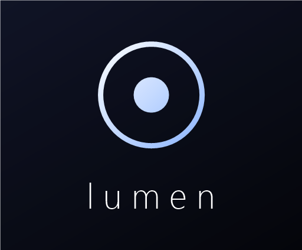
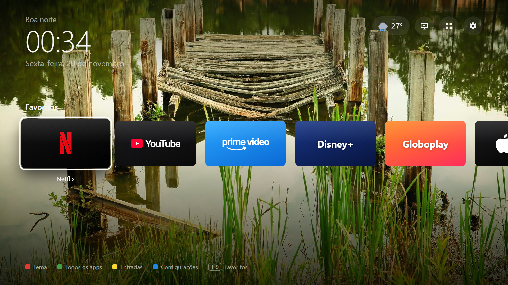
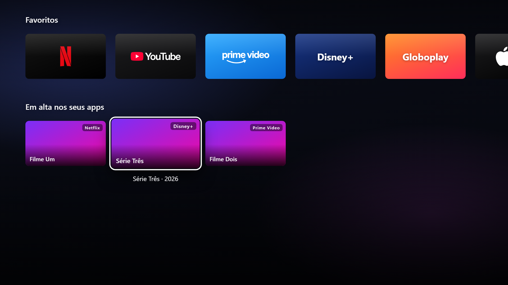
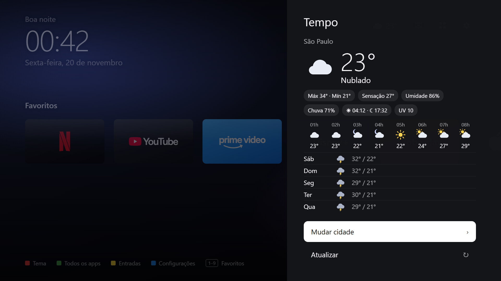
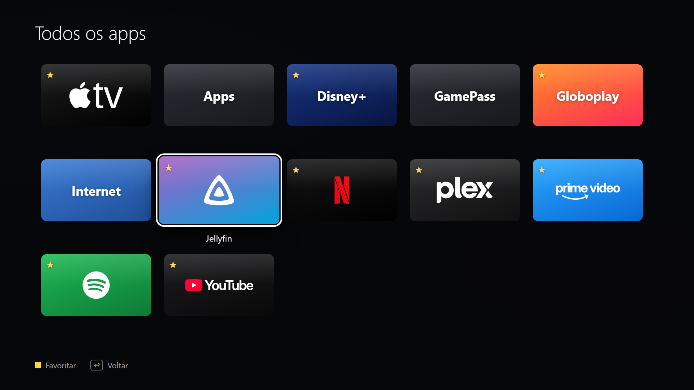
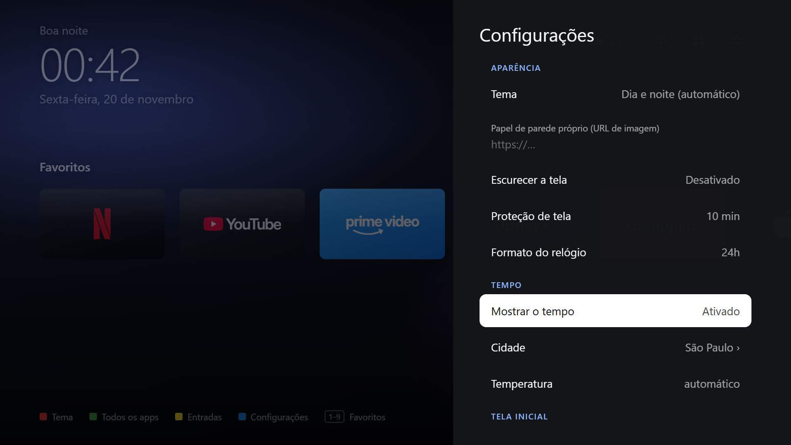
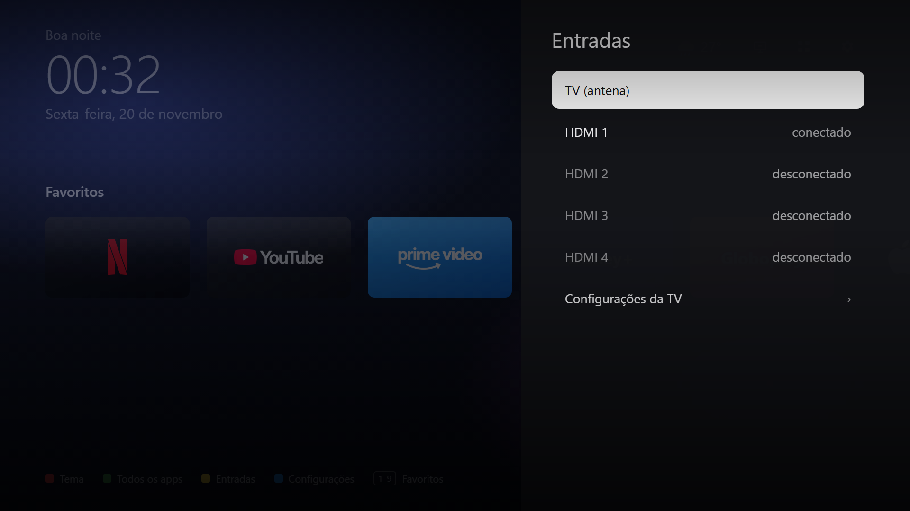
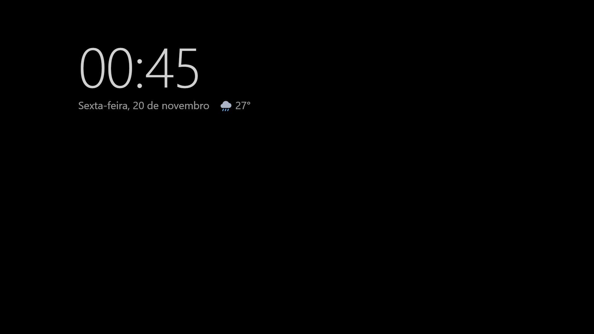

<div align="center">



# Lumen Launcher

**Uma tela inicial rápida, minimalista e sem anúncios para Smart TVs Samsung (Tizen).**<br>
**A fast, minimal, ad-free home screen for Samsung Smart TVs (Tizen).**

[Português](#português) · [English](#english)



 
 
 

<sub>Capturas do modo de desenvolvimento no navegador, com apps de exemplo · Browser preview with sample apps</sub>

</div>

---

## Português

### O que você ganha

- **Zero anúncios.** Nenhuma fileira patrocinada, banner ou vídeo promocional.
- **Seus apps, na frente.** O Lumen lê os apps instalados na própria TV e monta a fileira de favoritos sozinho na primeira vez. Você escolhe quais aparecem e em que ordem.
- **Recentes.** Uma fileira com o que você abriu por último.
- **Em alta nos seus apps** (opcional). Filmes e séries populares, mas só dos serviços instalados na TV, via TMDB. Precisa de uma chave gratuita, digitada nas Configurações.
- **O tempo num relance.** Temperatura no topo e um painel com as próximas horas, os próximos 5 dias, nascer e pôr do sol, UV e chance de chuva. Usa o Open-Meteo, sem chave e sem cadastro. A cidade vem do fuso horário da TV, ou você busca outra.
- **Entradas a um clique.** TV (antena), HDMI 1–4 (mostrando quais estão conectados) e as Configurações da TV.
- **Dia e noite.** O fundo vira céu de dia e céu noturno no pôr do sol real da sua cidade.
- **Outros fundos.** Foto do dia (uma imagem nova a cada dia), uma imagem sua por URL, ou preto puro, amigo de telas OLED e QLED.
- **Proteção de tela.** Relógio grande, data e tempo sobre fundo preto. Muda de lugar a cada minuto para não marcar a tela.
- **Escurecer.** Deixa as telas do Lumen mais escuras num quarto escuro. Pode ser automático, das 22h às 7h.
- **Atalhos web.** Qualquer site vira um bloco na tela inicial e abre no navegador da TV.
- **Teclas numéricas.** De 1 a 9, abrem direto o favorito correspondente.
- **Abre na hora.** Um boot curto ao ligar, e a TV pode manter o app pré-carregado na memória.
- **Leve.** HTML, CSS e JavaScript puro, sem frameworks. Nas TVs com pouca memória (≈1,5 GB, como muitos modelos de 2021), ele tira sombras e encurta animações sozinho.
- **Feito para o controle remoto.** O foco é sempre visível e nunca se perde, e cada tela lembra onde você estava.
- **Seguro.** Nada é removido nem alterado na TV, e a tela inicial da Samsung continua existindo.

> ℹ️ **Limitação do Tizen:** apps comuns não podem substituir o Smart Hub, e o botão **Home** sempre abre a tela da Samsung. O que dá para fazer é deixar o Lumen a um clique (veja o passo 4 abaixo).

### Teclas do controle

| Tecla | Na tela inicial | Em Todos os apps | Em Organizar favoritos |
|---|---|---|---|
| Setas / OK | Navegar / abrir | Navegar / abrir | OK pega e solta o app; ← → move |
| 🔴 Vermelha | Trocar o tema (dia/noite → noite → foto → preto) | — | Remover dos favoritos |
| 🟢 Verde | Todos os apps | — | Editar atalho web |
| 🟡 Amarela | Entradas (TV/HDMI) | Adicionar/remover dos favoritos ★ | — |
| 🔵 Azul | Configurações | — | — |
| 1–9 | Abrir o favorito nº 1–9 | — | — |
| Voltar | — | Voltar | Soltar / voltar |

#### “Em alta nos seus apps” (opcional)

1. Crie uma conta grátis em [themoviedb.org](https://www.themoviedb.org/signup).
2. Copie a **API Key** ou o **API Read Access Token** em [themoviedb.org/settings/api](https://www.themoviedb.org/settings/api).
3. Na TV, abra **Configurações → Chave TMDB** e digite a chave.

A fileira mostra títulos populares disponíveis por assinatura nos serviços instalados na TV. OK abre o app do serviço. *Usa a API do TMDB, sem endosso ou certificação do TMDB.*

### Instalar (≈10 minutos)

Você precisa de uma TV Samsung com Tizen e de um computador na mesma rede Wi-Fi. O alvo é o **Tizen 6.0 (2021)**. Versões mais novas devem funcionar.

1. **Na TV**, abra **Apps** e digite `1 2 3 4 5` no controle. Ligue o **Developer mode**, coloque o IP do seu computador em **Host PC IP** e reinicie a TV.
2. **No computador**, baixe o [TizenBrew Installer](https://github.com/reisxd/TizenBrewInstaller/releases/latest), abra o programa e conecte à sua TV.
3. **Instale pelo GitHub:** digite `emanueldonadon1/lumen-launcher`. Nas TVs de 2023 em diante, ele pede login na conta Samsung uma vez, para assinar o app para a sua TV.
4. **Deixe a um clique:** mova o Lumen para o **primeiro lugar** da barra do Smart Hub. Em algumas TVs, ligar **Autorun Last App** (em Configurações → Geral → Recursos Smart) faz a TV ligar direto no Lumen.

#### Assinatura do pacote

O `LumenLauncher.wgt` das releases já vem **assinado** com o certificado de autor Tizen do Lumen e o certificado público de distribuidor da Tizen, igual ao que o Tizen Studio gera. Isso é necessário porque:

- **Nas TVs até 2022 (Tizen ≤ 6)**, o TizenBrew Installer instala o pacote do jeito que baixou. Um pacote sem assinatura é recusado com `install failed[118, -12] Check certificate error`.
- **Nas TVs de 2023 em diante (Tizen 7+)**, o TizenBrew assina de novo com o seu certificado Samsung.

A assinatura é feita no GitHub Actions por [`tools/sign.ps1`](tools/sign.ps1), que roda em PowerShell 7 sem precisar do Tizen Studio. Para conferir um pacote: `pwsh tools/sign.ps1 -Verify LumenLauncher.wgt`.

#### Instalação manual (sem TizenBrew)

Requer Python 3 e PowerShell 7. Use o `.wgt` assinado da [última release](https://github.com/emanueldonadon1/lumen-launcher/releases/latest), colocado na raiz do projeto:

```bash
git clone https://github.com/emanueldonadon1/lumen-launcher && cd lumen-launcher
gh release download -p LumenLauncher.wgt     # ou baixe pelo navegador
python3 tools/install.py 192.168.1.50        # instala direto na TV, sem sdb/Tizen Studio
python3 tools/install.py 192.168.1.50 --uninstall
```

Erros comuns:
- `failed[118, -12] Check certificate error`: o pacote não está assinado. Use o `.wgt` da release v0.3.1 em diante.
- `failed[118]` depois de uma instalação que falhou: pode ter sobrado uma cópia assinada com outro certificado. Rode `--uninstall` antes.
- `failed[116]`: falta espaço livre na TV.

### Desenvolver

Abra `src/index.html` no Chrome do computador. A tela se ajusta à janela e usa uma lista de apps de exemplo.

| Teclado | Controle |
|---|---|
| Setas / Enter | Setas / OK |
| Esc ou Backspace | Voltar |
| F1 / F2 / F3 / F4 | Vermelha / Verde / Amarela / Azul |

Regras do código, por causa do Chromium M76 do Tizen 6.0:
- No máximo **ES2017**. Nada de `?.` ou `??`.
- Nada de `gap` em flexbox, `aspect-ratio` ou `inset`.
- Animações só com `transform` e `opacity`.

O workflow `check.yml` valida essas regras a cada push.

**Publicar uma versão:** atualize `version` no `src/config.xml` e crie a tag (`git tag v0.2.0 && git push --tags`). O GitHub Actions gera o `LumenLauncher.wgt` e anexa à release, e é de lá que o TizenBrew instala.

---

## English

### What you get

- **No ads.** No sponsored rows, banners or autoplaying promos.
- **Your apps, up front.** Lumen reads the apps installed on the TV itself and builds the favorites row on first run. You pick which ones show and in what order.
- **Recent apps**, and an optional **Trending on your apps** row: popular titles streaming on the services installed on this TV, from TMDB, with your own free key.
- **Weather at a glance.** Temperature in the top bar and a panel with the next hours, 5 days, sunrise/sunset, UV and rain chance. It uses Open-Meteo, with no key. The city comes from the TV's time zone, or you can search for one.
- **Inputs one press away.** TV, HDMI 1–4 (showing which are connected) and the TV's settings.
- **Day & night.** The background follows your city's real sunset. Other options: photo of the day, your own image URL, or pure black.
- **Screensaver** with a big drifting clock (burn-in safe), and **dimming** for dark rooms (it can turn on automatically from 10pm to 7am).
- **Number keys 1–9** open favorites directly.
- **Web shortcuts.** Any website becomes a tile that opens in the TV's browser.
- **Instant.** A short boot, and the TV may keep the app pre-launched in memory.
- **Light.** Plain HTML, CSS and JavaScript, no frameworks. On low-memory sets (≈1.5 GB, like many 2021 models) it drops shadows and shortens animations automatically.
- **Built for the remote.** Focus is always visible and never gets lost, and every screen remembers where you were.
- **Wallpaper or pure black.** The pure black mode is friendly to OLED and QLED screens.
- **Safe.** Nothing on the TV is removed or changed, and Samsung's home screen stays where it is.

> ℹ️ **Tizen limitation:** regular apps cannot replace Smart Hub, and the **Home** button always opens Samsung's screen. Lumen sits one press away instead (see step 4).

### Install (≈10 minutes)

1. **On the TV**, open **Apps** and type `1 2 3 4 5` on the remote. Turn **Developer mode** on, enter your computer's IP in **Host PC IP**, and restart the TV.
2. **On your computer**, run [TizenBrew Installer](https://github.com/reisxd/TizenBrewInstaller/releases/latest) and connect to the TV.
3. **Install from GitHub:** type `emanueldonadon1/lumen-launcher`. On 2023+ TVs it asks you to sign in to your Samsung account once, to sign the app for your TV.
4. **One press away:** move Lumen to the **first slot** of the Smart Hub bar. On some TVs, **Autorun Last App** makes the TV turn on straight into Lumen.

Manual install: run `python3 tools/build.py --sign <profile>`, then `python3 tools/install.py <TV IP>`. Python 3 is the only requirement, with no Tizen Studio or sdb. See the Portuguese section above for the commands.

### Develop

Open `src/index.html` in desktop Chrome.

| Keyboard | Remote |
|---|---|
| Arrows / Enter | Arrows / OK |
| Esc or Backspace | Back |
| F1 / F2 / F3 / F4 | Red / Green / Yellow / Blue |

Target: Chromium M76 (Tizen 6.0). That means ES2017 at most, no flexbox `gap`, and only `transform`/`opacity` animations.

---

## Credits

Lumen's Samsung layer stands on the field-tested work of [**Free My TV**](https://github.com/simbasjungles/free-my-tv) (MIT). From it come the SDB installer, the system-app filter, the DIAL fallback, the memory-based performance tiers and the app logos. See [NOTICE.md](NOTICE.md).

App names and logos belong to their owners. Lumen is not affiliated with Samsung or any streaming service.

MIT © Lumen Launcher contributors
